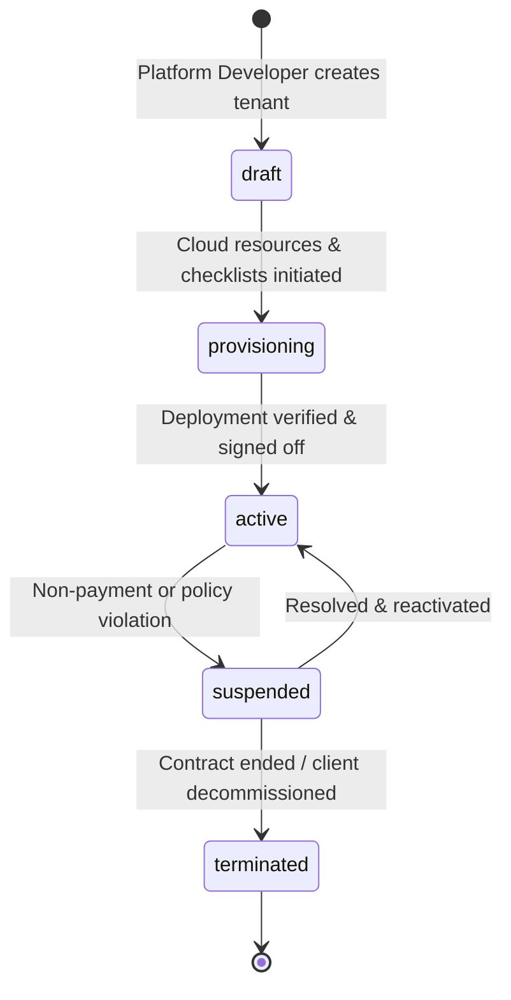

# Tenant Isolation Strategy & Lifecycle Architecture

## 1. Multi-Tenant Isolation Philosophy

A white-label commercial platform handles sensitive business assets: pricing formulas, customer contact lists, order books, breeder lineages, and supplier contracts. A data leak between two rival poultry farms or cooperatives would be catastrophic.

Therefore, our isolation model rejects the naive assumption that adding a `tenantId` field to records is sufficient on its own. We enforce a **defense-in-depth architecture** spanning project infrastructure, database security rules, backend middleware, and network layers.

---

## 2. Dual-Mode Isolation Architecture

### 2.1 Mode A: Physical Isolation (Production Target - Separate Firebase Project per Tenant)
For enterprise clients in production, each client receives their own provisioned Google Cloud / Firebase Project.

```
┌────────────────────────────────┐         ┌────────────────────────────────┐
│   CLIENT A FIREBASE PROJECT    │         │   CLIENT B FIREBASE PROJECT    │
│   (e.g., "poultry-client-a")   │         │   (e.g., "poultry-client-b")   │
│                                │         │                                │
│ • Isolated Firestore Engine    │         │ • Isolated Firestore Engine    │
│ • Separate Storage Buckets     │         │ • Separate Storage Buckets     │
│ • Independent Auth User Pool   │         │ • Independent Auth User Pool   │
│ • Dedicated API Quotas         │         │ • Dedicated API Quotas         │
│ • Dedicated Regional Residency │         │ • Dedicated Regional Residency │
└────────────────────────────────┘         └────────────────────────────────┘
```
**Benefits:**
- **Zero Cross-Query Vulnerabilities**: Impossible for a query from Client A to ever match or return documents belonging to Client B.
- **Granular Quotas & Throttling**: A surge in traffic during peak hatching season on Client A does not degrade performance or exhaust API limits for Client B.
- **Data Sovereignty & Compliance**: Data can be located in distinct GCP geographical regions (e.g. `europe-west3` for European privacy, `asia-south1` for Indian data localisation).

### 2.2 Mode B: Logical Isolation (Staging / Shared Namespace Mode)
For testing, staging, and smaller tier clients, the platform provides rigorous logical multi-tenancy within a single shared database instance under the path:
```
/tenants/{tenantId}/[subcollections]
```

**Enforcement via Firestore Security Rules:**
```javascript
match /tenants/{tenantId} {
  // Only users authenticated with matching tenantId claim can access
  function belongsToTenant() {
    return request.auth != null && 
           request.auth.token.tenantId == tenantId;
  }

  match /{allSubcollections=**} {
    allow read, write: if isPlatformDeveloper() || belongsToTenant();
  }
}
```

---

## 3. Tenant Lifecycle State Machine

A tenant progresses through a formal state machine managed by the Developer Control Panel:



### 3.1 State Definitions & Enforcement

| State | Allowed Operations | Enforcement Policy |
|---|---|---|
| `draft` | Platform Developer configuration only | Mobile app access blocked; client admins cannot log in. |
| `provisioning` | Automated / manual resource creation | Access limited to platform engineers verifying smoke tests. |
| `active` | Full operational access | All enabled feature entitlements accessible to buyers and sellers. |
| `suspended` | Read-only or blocked | All create/update mutations reject with `tenant-suspended`. Mobile app displays suspension banner. |
| `terminated` | Read-only archival or deletion | All client authentication rejected immediately. |

### 3.2 State Enforcement in Backend Middleware
```typescript
export async function assertTenantActive(tenantId: string): Promise<TenantRecord> {
  const doc = await db.doc(`control_plane/v1/tenants/${tenantId}`).get();
  if (!doc.exists) {
    throw new HttpsError('not-found', `Tenant ${tenantId} not found.`);
  }
  const tenant = doc.data() as TenantRecord;
  if (tenant.lifecycleState !== 'active') {
    throw new HttpsError(
      'failed-precondition', 
      `Tenant ${tenantId} is currently ${tenant.lifecycleState}. Operation prohibited.`
    );
  }
  return tenant;
}
```
